<div align="center">

<a href="https://github.com/ishandutta2007/Awesome-LLM-Context-Memory-Optimization">
  
</a>

<p align="center">
  <a href="https://github.com/ishandutta2007/Awesome-Awesome-Awesome"></a><a href="https://discord.gg/jc4xtF58Ve"></a>
  <a href="https://github.com/ishandutta2007/Awesome-LLM-Context-Memory-Optimization/stargazers"></a>
  <a href="https://github.com/ishandutta2007/Awesome-LLM-Context-Memory-Optimization/network/members"></a>
  <a href="https://github.com/ishandutta2007/Awesome-LLM-Context-Memory-Optimization/issues"></a>
  <a href="https://github.com/ishandutta2007/Awesome-LLM-Context-Memory-Optimization/blob/main/LICENSE"></a>
  <a href="https://github.com/ishandutta2007/Awesome-LLM-Context-Memory-Optimization/pulls"></a>
  <a href="https://github.com/ishandutta2007"></a>
</p>

<p align="center">
  <strong>A curated ecosystem of SaaS platforms, enterprise solutions, and open-source infrastructure for LLM Context Window Optimization, Long-Term Agent Memory, Temporal Knowledge Graphs, KV Compression &amp; Semantic Caching.</strong>
</p>

<p align="center">
  <code>#LLM-Memory</code> • <code>#Agent-Context</code> • <code>#Semantic-Caching</code> • <code>#Knowledge-Graphs</code> • <code>#KV-Compression</code> • <code>#AI-Agents</code> • <code>#Context-Engineering</code>
</p>

</div>

---

## 📑 Table of Contents

- [🌟 Overview](#-overview)
- [📊 Sector Overview & Market Dynamics](#-sector-overview--market-dynamics)
- [🏢 SaaS & Hosted Memory Platforms](#-saas--hosted-memory-platforms)
- [💻 Open-Source GitHub Projects](#-open-source-github-projects)
- [🏗️ Architectural Taxonomies & Comparison](#️-architectural-taxonomies--comparison)
- [🤝 How to Contribute](#-how-to-contribute)
- [📈 Star History](#-star-history)
- [💖 Support & Community](#-support--community)
- [⚖️ Disclaimer & License](#️-disclaimer--license)

---

## 🌟 Overview

As Large Language Models (LLMs) transition from stateless single-turn chatbots into long-horizon, autonomous agents, managing context windows and durable recall has become mission-critical. Feeding exhaustive conversation histories and unstructured context into multi-turn prompts leads to severe latency penalties, quadratic attention cost, context distraction ("needle-in-a-haystack" degradation), and skyrocketing API bills.

This curated list tracks leading **SaaS platforms** and **open-source repositories** engineering context memory optimization through:
- 🧠 **Persistent Agent Memory:** Long-term memory extraction across user, session, run, and organization scopes.
- 🕸️ **Temporal Knowledge Graphs:** Bi-temporal edge tracking (`valid_at` vs `created_at`) preventing outdated fact hallucinations.
- ⚡ **Semantic Prompt Caching:** Zero-false-hit vector & exact caches bypassing repetitive inference calls.
- 📦 **OS-Inspired Context Paging:** Virtual memory paging in and out of active model context windows.
- 📉 **KV Cache Compression & Eviction:** Training-free retention of critical attention heads and token neighborhoods.

---

## 📊 Sector Overview & Market Dynamics

The AI Agent Memory and Context Optimization sector forms the core infrastructure tier of the emerging agentic economy. 

- **Estimated Market Size & Growth:** The specialized market for **AI Agent Orchestration & Persistent Context Systems** is valued at approximately **$6.27 billion in 2024–2025** and is projected to expand to **$28.45 billion by 2030** (surging at a Compound Annual Growth Rate of **~35.3% to 46.3%**). This trajectory is heavily accelerated by enterprise demand for production agents that execute cross-session business workflows without token exhaustion.
- **Fragmentation vs. Concentration:** The market is currently **moderately-to-highly fragmented** rather than an early "winner-take-all" monopoly. Unlike traditional cloud compute where hyper-scalers dominate, memory systems diverge drastically based on engineering trade-offs:
  - *Ultra-low-latency semantic caching* (Redis, Bifrost, GPTCache) vs.
  - *Dynamic graph reasoning and temporal fact resolution* (Graphiti, Cognee) vs.
  - *OS-style multi-tiered memory paging* (Letta, OpenViking) vs.
  - *Lightweight local and coding agent memory* (Hindsight, Deja-Vu, GrayMatter).
  
  Because data privacy regulations (GDPR/HIPAA), on-premise self-hosting requirements, and operational footprints vary between client-side and cloud agents, specialized architectures continue to thrive across distinct niches.

---

## 🏢 SaaS & Hosted Memory Platforms

The table below catalogs managed SaaS platforms and cloud memory layers. Entries are sorted in **descending order by company valuation / scale**.

| Company / Product | Valuation / Scale | Starting Paid Tier Pricing | Free Forever / Trial Limit | Key Focus & Capabilities |
| :--- | :--- | :--- | :--- | :--- |
| **[Redis Cloud (LangCache)](https://redis.io/solutions/genai/)** | **$2.0B Valuation**<br>*(~$300M ARR; Series G)* | **$5.00 / mo**<br>*(Fixed 250 MB tier at $0.007/hr; pay-as-you-go)* | **Free Forever:**<br>30 MB storage, 1 database, 30 concurrent connections | In-memory dual-tier memory (working + long-term) with sub-millisecond semantic prompt caching and HNSW vector search. |
| **[LangChain (LangSmith / LangMem)](https://www.langchain.com/langsmith)** | **$1.25B Valuation**<br>*($125M Series B led by IVP)* | **$39.00 / user / mo**<br>*(Plus Plan; includes 10k base traces/mo, $2.50/1k overage)* | **Free Forever:**<br>1 user seat, 5,000 base traces / mo, 14-day data retention | Native LangGraph/LangChain memory extraction, episodic thread persistence, reflection loops, and trace observability. |
| **[Pinecone (Assistant & Memory)](https://www.pinecone.io/)** | **$750M Valuation**<br>*($138M raised; Series B)* | **$0.33 per 1M read units**<br>*(Standard Serverless; ~$10/mo minimum spend)* | **Free Forever:**<br>1 project, up to 100,000 vectors (2 GB storage), 2M read units/mo | Managed serverless vector infrastructure with integrated context indexing, metadata filtering, and semantic search. |
| **[Mem0 Cloud](https://mem0.ai/)** | **~$100M Valuation**<br>*($24.5M raised; Series A)* | **$19.00 / mo**<br>*(Starter Plan; 50k add requests, 5k retrieval requests/mo)* | **Free Forever:**<br>10,000 add requests/mo, 1,000 retrieval requests/mo, 1 project | Multi-scoped memory extraction (user, agent, run), auto-deduplication, entity graphs, and 80ms p95 search latency. |
| **[Letta Cloud (MemGPT)](https://www.letta.com/)** | **$70M Valuation**<br>*($10M Seed led by Felicis)* | **$20.00 / mo**<br>*(Pro Plan; 20 stateful agents, remote sandboxes, managed quotas)* | **Free Forever:**<br>Up to 3 stateful agents, Bring-Your-Own-Key (BYOK), community support | Hosted Agent Development Environment (ADE), OS-style context paging, long-running agent threads, and file attachments. |
| **[Recall.ai](https://www.recall.ai/)** | **~$50M Valuation**<br>*($12.7M raised; Series A)* | **$0.75 / bot-hour**<br>*(Pay-as-you-go transcription & memory ingestion)* | **Free Trial:**<br>14-day trial with $10 in usage credits (~13 hours of meeting ingestion) | Meeting, audio, and video context capture pipelines feeding real-time conversational memory directly into agent stacks. |
| **[Supermemory](https://supermemory.ai/)** | **~$20M Valuation**<br>*($3.0M Seed led by Susa)* | **$19.00 / mo**<br>*(Pro Plan; includes $20/mo credits, MCP plugins, 3 seats)* | **Free Forever:**<br>$5 monthly usage credits (~500k tokens stored), 1 seat, unlimited end-users | Personal & agent memory profile API, Chrome browser extension sync, Claude Code & Cursor MCP servers. |
| **[Zep Cloud](https://www.getzep.com/)** | **~$15M Valuation**<br>*($2.3M Seed; Engineering Cap)* | **$125.00 / mo**<br>*(Flex Plan; 50k credits/mo, 5 projects, 5 MCP seats, 600 RPM)* | **Free Forever:**<br>10,000 credits/mo, 1 project, unmetered retrieval & graph storage | Temporal knowledge graph engine, bi-temporal fact invalidation, cross-encoder reranking, and ~50ms search latency. |
| **[Graphlit](https://www.graphlit.com/)** | **~$1.5M Valuation**<br>*(Bootstrapped / Angel funded)* | **$49.00 / mo**<br>*(Hobby Plan; up to 10 GB content storage; service winding down)* | **Free Forever:**<br>Legacy tier with 100 credits/mo and 1 GB storage *(new signups closed)* | Multimodal ingestion (documents, audio, web) into an automated semantic knowledge graph and context retrieval layer. |

---

## 💻 Open-Source GitHub Projects

Explore the leading self-hosted and open-source frameworks for agent memory, temporal graphs, semantic caching, and KV compression. 

Repositories are **sorted strictly in descending order by GitHub Stars_Count**:

1. **[Mem0](https://github.com/mem0ai/mem0)** [](https://github.com/mem0ai/mem0/stargazers)  
   **The universal memory layer for AI agents and assistants (Apache 2.0).**  
   - Drop-in architecture: `pip install mem0ai`, initialize `Memory()`, and gain persistent cross-session state in five lines of code.
   - Extracts semantic facts, links entities, and organizes state across multiple scopes: `user_id`, `agent_id`, `session_id`, and `org_id`.
   - Default stack integrates SQLite for change history, Qdrant for dense vectors, and LLM-guided memory update/delete heuristics.
   - Self-hosted Docker server features multi-tenant API key management and full audit logs. LOCOMO benchmark SOTA (84.5%).

2. **[Hindsight](https://github.com/vectorize-io/hindsight)** [](https://github.com/vectorize-io/hindsight/stargazers)  
   **Agent Memory That Learns.**  
   - Continuous self-improving memory architecture designed to help agents adapt to user preferences and dynamic tasks over time.
   - Integrates reinforcement feedback loops directly into the memory retrieval index, pruning irrelevant context dynamically.

3. **[OpenViking](https://github.com/volcengine/OpenViking)** [](https://github.com/volcengine/OpenViking/stargazers)  
   **Self-evolving Context Database for AI Agents.**  
   - Unifies Agent Memory, Knowledge RAG, and Skill Library into a cohesive high-performance vector-relational context database.
   - Engineered for massive production agent deployments requiring high concurrency and zero memory fragmentation.

4. **[Cognee](https://github.com/topoteretes/cognee)** [](https://github.com/topoteretes/cognee/stargazers)  
   **Deterministic Memory & Knowledge Engine for AI Agents.**  
   - Bridges the gap between vector stores and graph databases by building structured, interconnected knowledge graphs from conversational context.
   - Organizes raw documents and chats into typed topological hierarchies for deterministic multi-hop reasoning.

5. **[Graphiti](https://github.com/getzep/graphiti)** [](https://github.com/getzep/graphiti/stargazers)  
   **Temporal Knowledge Graph framework developed by Zep (Apache 2.0).**  
   - Features a **bi-temporal edge model**: each relational edge records `valid_at` (real-world event time) and `created_at` (graph ingestion time).
   - Resolves conflicting facts across time (e.g., "I live in Paris" → "I moved to Tokyo") without destructive overwrites, preserving historical context.
   - Employs cross-encoder reranking over Neo4j or Kùzu backends to deliver superior retrieval precision compared to cosine distance.

6. **[Supermemory](https://github.com/supermemoryai/supermemory)** [](https://github.com/supermemoryai/supermemory/stargazers)  
   **Personal & Agent Memory Hub with MCP Integrations.**  
   - Open-source second-brain engine providing long-term recall, bookmark indexing, and user profile management.
   - Native Model Context Protocol (MCP) server enables direct connections from Claude Code, Cursor, Windsurf, and custom agent loops.

7. **[TencentDB-Agent-Memory](https://github.com/TencentCloud/TencentDB-Agent-Memory)** [](https://github.com/TencentCloud/TencentDB-Agent-Memory/stargazers)  
   **Team-Level Memory Hub for Collaborative AI Agents.**  
   - Converts conversations, docs, and code into four reusable memory assets: Chat Memory, Skill Bank, LLM-Wiki, and Code-Graph.
   - Built for enterprise governance, shared multi-agent state, and zero-redundancy cross-agent context sharing.

8. **[Letta (MemGPT)](https://github.com/letta-ai/letta)** [](https://github.com/letta-ai/letta/stargazers)  
   **Stateful Agent Runtime with OS-Inspired Virtual Memory Paging.**  
   - Empowers LLM agents to maintain perpetual life by managing memory tiers analogous to OS paging: Core Memory (RAM/active context) and Archival Memory (Disk/vector DB).
   - Agents autonomously edit, append, and prune their own memory blocks using built-in system tools.
   - Ships with an Agent Development Environment (ADE) web UI, REST API server on port 8283, and PostgreSQL migration support.

9. **[Bifrost](https://github.com/maximhq/bifrost)** [](https://github.com/maximhq/bifrost/stargazers)  
   **Ultra-Fast AI Gateway with Sub-200µs Semantic Caching.**  
   - High-performance enterprise AI gateway supporting 10,000+ models with integrated semantic caching, virtual keys, and prompt deduplication.
   - Saves up to 40% in API costs by evicting redundant queries at the network perimeter before reaching model providers.

10. **[GPTCache](https://github.com/zilliztech/GPTCache)** [](https://github.com/zilliztech/GPTCache/stargazers)  
    **Semantic Cache for LLMs by Zilliz.**  
    - High-speed caching layer that intercepts identical and semantically similar prompts to bypass inference latency and LLM costs.
    - Modular architecture supporting multiple embedding models, similarity evaluation algorithms, and vector stores (Milvus, Chroma, FAISS, Redis).

11. **[RuVector](https://github.com/ruvnet/RuVector)** [](https://github.com/ruvnet/RuVector/stargazers)  
    **Real-Time Vector GNN Database Built in Rust.**  
    - Blends high-performance Graph Neural Networks with vector search for sub-millisecond agent memory retrieval.
    - Extreme memory efficiency with zero-copy Rust serialization for embedded and edge-device agents.

12. **[CozoDB](https://github.com/cozodb/cozo)** [](https://github.com/cozodb/cozo/stargazers)  
    **Transactional Relational-Graph-Vector Hybrid Database.**  
    - Graph-relational hybrid DB using Datalog for complex rule execution, graph pattern matching, and HNSW vector similarity search in a single embedded engine.
    - Ideal backing store for agents requiring temporal graph validation and multi-entity queries.

13. **[XERJ](https://github.com/xerj-org/xerj)** [](https://github.com/xerj-org/xerj/stargazers)  
    **High-Efficiency Token-Saving Code & Document Memory Engine.**  
    - Auto-indexes codebases, documentation, and system logs to feed agents precise context slices with 40× fewer tokens than naive grep/sed retrieval.
    - Elasticsearch-compatible API for transparent integration with existing tools.

14. **[Agent-Memory (tigerless-labs)](https://github.com/tigerless-labs/agent-memory)** [](https://github.com/tigerless-labs/agent-memory/stargazers)  
    **Markdown-Native Long-Term Memory Runtime for Coding Agents.**  
    - Plain Markdown as the single source of truth, local BM25 + dense ranking, and a detached "sleep-time" consolidation engine.
    - Shared unified store between Claude Code, Codex, and Cursor without external cloud dependencies.

15. **[LangMem](https://github.com/langchain-ai/langmem)** [](https://github.com/langchain-ai/langmem/stargazers)  
    **Long-Term Memory Toolkit by LangChain.**  
    - SDK designed for extracting, querying, and updating agent memories within LangGraph and LangChain workflows.
    - Supports background extraction, profile memory creation, episodic conversation summarization, and semantic clustering.

16. **[nautilus-compass](https://github.com/chunxiaoxx/nautilus-compass)** [](https://github.com/chunxiaoxx/nautilus-compass/stargazers)  
    **MCP-Native Memory with Behavioral Drift Detection.**  
    - Built-in drift detection (AUC 0.83 on held-out agent failure traces) and Merkle tree integrity audit logging.
    - Benchmarks **P@1 0.890** on LongMemEval-S retrieval, exceeding baseline vector memory implementations.

17. **[A-mem](https://github.com/agiresearch/A-mem)** [](https://github.com/agiresearch/A-mem/stargazers)  
    **Agentic Memory for LLM Agents.**  
    - Dynamic agent-centric memory management simulating cognitive memory consolidation, semantic associations, and memory decay.

18. **[deja-vu](https://github.com/vshulcz/deja-vu)** [](https://github.com/vshulcz/deja-vu/stargazers)  
    **Zero-LLM Coding Agent Memory Engine.**  
    - Compiles persistent memory directly from existing session history on disk across 40+ IDEs and agents (Claude Code, Codex, Cursor).
    - Ships as a single Go binary with native MCP tools and zero token usage during memory compilation.

19. **[ModelCache](https://github.com/codefuse-ai/ModelCache)** [](https://github.com/codefuse-ai/ModelCache/stargazers)  
    **Enterprise Semantic Caching System by CodeFuse.**  
    - Enhances user experience and lowers inference overhead via dynamic query-result caching and prompt normalization.

20. **[GrayMatter](https://github.com/angelnicolasc/graymatter)** [](https://github.com/angelnicolasc/graymatter/stargazers)  
    **Go-Based Memory Engine with Massive Token Reduction.**  
    - Achieves **90% token reduction at 100 sessions** (6,960 tokens → 670 tokens) via proactive context compaction.
    - Provides 7 MCP tools, interactive TUI graph explorer, and 25 verified IDE configurations (Cursor, Windsurf, Claude Code).

21. **[total-agent-memory](https://github.com/vbcherepanov/total-agent-memory)** [](https://github.com/vbcherepanov/total-agent-memory/stargazers)  
    **Local Memory Server with 6-Stage Recall Pipeline.**  
    - Hybrid retrieval: BM25 (SQLite FTS5) + Dense (FastEmbed) + Fuzzy + Graph Expansion + CrossEncoder + MMR diversity.
    - Includes 3D WebGL knowledge graph viewer rendering 3,500+ nodes, Agent-to-Agent (A2A) sync, and phase-scoped rules reducing tokens by ~70%.

22. **[ICO-Cache](https://github.com/DEV-S-SHAH/ICO)** [](https://github.com/DEV-S-SHAH/ICO/stargazers)  
    **Generalized LLM Semantic Cache with 0% False Hits.**  
    - Benchmarked **0% false-hit rate** on 100 adversarial near-miss negatives and **100% true-hit rate** on paraphrased queries with ~46ms latency.
    - Multi-layer verification: Exact hash + LanceDB semantic vector + strict entity and topic metadata guards.

23. **[deepcq](https://github.com/ternary-ai/deepcq)** [](https://github.com/ternary-ai/deepcq/stargazers)  
    **Zero-Embedding Intent-Aware Memory Querying.**  
    - Evaluates query relevance using regex and token stemming without heavy vector databases or external embedding models.
    - Implements five memory tiers: AppState, SessionCache (LRU), History (sliding window), LongTermStore, and ReferenceData.

24. **[nearlossless-context](https://github.com/nilsperssonsuorra/nearlossless-context)** [](https://github.com/nilsperssonsuorra/nearlossless-context/stargazers)  
    **Training-Free KV Cache Compression for Long Contexts.**  
    - Retains critical local attention neighborhoods while dynamically compressing trailing tokens; maintains flat VRAM from 4k to 40k tokens.
    - Posthoc query-aware mode delivers **0.95–1.0× full F1** retrieval at a fraction of standard GPU memory requirements.

---

## 🏗️ Architectural Taxonomies & Comparison

Understanding how each context optimization technique solves the prompt overhead problem:

```
┌─────────────────────────────────────────────────────────────────────────────┐
│                       LLM CONTEXT OPTIMIZATION STACK                        │
└─────────────────────────────────────────────────────────────────────────────┘
                                       │
      ┌────────────────────────────────┼──────────────────────────────┐
      ▼                                ▼                              ▼
┌──────────────┐              ┌─────────────────┐            ┌────────────────┐
│   CACHING    │              │  GRAPH & STATE  │            │  COMPRESSION   │
│  MIDDLEWARE  │              │  PERSISTENCE    │            │  & PAGING      │
├──────────────┤              ├─────────────────┤            ├────────────────┤
│ • GPTCache   │              │ • Mem0          │            │ • Letta (OS)   │
│ • Redis      │              │ • Graphiti      │            │ • NearLossless │
│ • Bifrost    │              │ • Cognee        │            │ • total-memory │
│ • ICO-Cache  │              │ • OpenViking    │            │ • deepcq       │
└──────────────┘              └─────────────────┘            └────────────────┘
```

| Memory Paradigm | Primary Mechanism | Best Suited For | Key Trade-offs |
| :--- | :--- | :--- | :--- |
| **Semantic Caching** | Embedding similarity & exact hashes bypass model call | High-volume repetitive user queries, FAQ bots, cost reduction | Cannot handle stateful reasoning or novel dynamic queries |
| **Temporal Graphs** | Bi-temporal directed edges (`valid_at`, `created_at`) | Evolving world models, personal assistant history, fact auditing | Requires graph DB (Neo4j/Kùzu) & higher extraction compute |
| **OS-Style Paging** | Core RAM vs Archival disk paging via agent tool calls | Autonomous multi-step agents, indefinite runtime workflows | Higher token overhead per agent self-reflection step |
| **Hybrid BM25+Dense** | FTS5 + local vector embeddings + cross-encoder rerank | Local coding assistants (Cursor, Claude Code), offline agents | Resource-limited compared to cloud knowledge bases |
| **KV Cache Pruning** | Head pruning, attention eviction, neighborhood pooling | Self-hosted long-context model inference on local GPUs | Requires low-level model inference access (vLLM/PyTorch) |

---

## 🤝 How to Contribute

We welcome additions, corrections, and benchmark submissions from researchers and developers!

1. Fork this repository: `https://github.com/ishandutta2007/Awesome-LLM-Context-Memory-Optimization`
2. Create your feature branch: `git checkout -b feature/add-new-memory-engine`
3. Follow the standard format:
   - Include project name, official GitHub / website URL.
   - For open-source repos: include Stars_Badge linked to stargazers and insert in sorted order.
   - For SaaS tools: include verified starting price, free tier details, and company valuation.
4. Submit a Pull Request with a concise summary of the framework and benchmark evidence.

For broader collections of curated tools and resources, visit [Awesome-Awesome-Awesome](https://github.com/ishandutta2007/Awesome-Awesome-Awesome).

---

## 📈 Star History

[](https://star-history.dera.page/#ishandutta2007/Awesome-LLM-Context-Memory-Optimization&type=date&legend=top-left)

---

## 💖 Support & Community

Thank you for exploring and utilizing the **Awesome LLM Context & Memory Optimization** curated ecosystem! Building and maintaining stateful, token-efficient AI agents is rapidly advancing, and this repository thrives through community contributions.

If you find this repository valuable:
- ⭐ **Star this repository** to show your support and help other engineers discover it.
- 🍴 **Fork it** and contribute new memory frameworks, benchmarks, or architectural patterns.
- 📢 **Share** with your fellow AI researchers, agent developers, and engineering teams.
- ☕ **Sponsor the Maintainer:** Consider buying a coffee or supporting ongoing open-source curation via the [GitHub Sponsor Dashboard](https://github.com/sponsors/ishandutta2007).

<p align="center">
  <a href="https://github.com/sponsors/ishandutta2007">
    
  </a>
</p>

---

## ⚖️ Disclaimer & License

- This repository is a community-curated technical index and does not constitute an endorsement.
- Verify enterprise data protection compliance (GDPR, CCPA, SOC 2, HIPAA) when deploying memory platforms that ingest end-user context.
- Licensed under the [MIT License](LICENSE).
